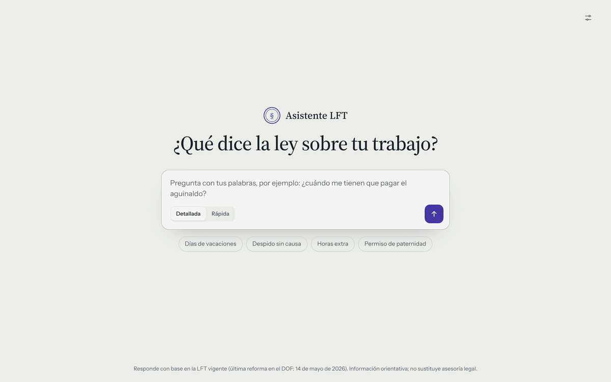
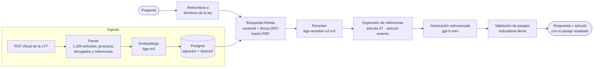

<div align="center">

# § Asistente LFT

**Pregúntale a la Ley Federal del Trabajo en tus palabras y lee el artículo exacto que sustenta cada respuesta.**




<sub>Respuesta real del sistema. La espera de la búsqueda y la generación está acelerada.</sub>

</div>

---

Las preguntas laborales suelen responderse "de memoria" y la LFT se reforma con frecuencia. Este asistente
responde **solo con el texto vigente de la ley** (última reforma DOF 14-05-2026), cita el artículo de cada
afirmación y **resalta la frase literal** que la sustenta. Si la ley no lo dice, lo dice.

| Corrección (juez, 1–5) | Pasajes verificables | Abstención correcta | Falsa abstención | Artículo correcto en el top-5 |
|:---:|:---:|:---:|:---:|:---:|
| **4.86** | **100 %** | **100 %** | **0 %** | **97 %** |

<sub>Evaluación sobre 40 preguntas (36 con respuesta en la ley, 4 fuera de alcance). Detalle en
<a href="#evaluación-cada-mejora-medida">Evaluación</a>.</sub>

## Cómo funciona



- **Sin LangChain ni LlamaIndex:** cada paso está escrito a mano para poder explicarlo y medirlo por separado.
- **La respuesta llega por streaming (SSE):** primero el avance de cada etapa, luego la frase principal y después cada párrafo con sus citas.
- **Cada pasaje es texto literal del artículo.** El backend nunca devuelve la frase que escribió el modelo, sino el
  tramo recortado del artículo real (exacto → normalizado → difuso → sin resaltar). Por construcción, lo que se
  resalta está en la ley.
- **Reglas que viven en código, no solo en el prompt:** un párrafo sin cita válida se elimina; si no queda ninguno, el sistema se abstiene.

## Evaluación: cada mejora, medida

Cada cambio al pipeline se evaluó contra el mismo set y se registró en
[`docs/decisiones.md`](docs/decisiones.md), incluidos los que **no** funcionaron.

| # | Configuración | Top-5 | MRR | Recall | Falsa abst. | Corrección |
|:-:|---|:-:|:-:|:-:|:-:|:-:|
| 1 | Chunks fijos de 500 tokens (línea base) | 89 % | 0.717 | 88 % | 11 % | 4.50 |
| 2 | Un chunk por artículo | 86 % | 0.764 | 80 % | 8 % | 4.33 |
| 3 | + búsqueda híbrida (vectorial + léxica, RRF) | 83 % | 0.563 | 73 % | 8 % | 4.19 |
| 4 | Híbrida + reranker cross-encoder | 89 % | 0.763 | 86 % | 6 % | 4.50 |
| 5 | + expansión de referencias cruzadas | 89 % | 0.763 | 89 % | 3 % | 4.64 |
| 6 | + reescritura de consulta | 86 % | 0.758 | 88 % | 8 % | 4.58 |
| 7 | Reranker con la consulta reescrita | 94 % | **0.811** | 94 % | 0 % | 4.75 |
| 8 | **Reranker con ambas consultas + respuesta estructurada con pasajes** | **97 %** | 0.804 | **96 %** | **0 %** | **4.86** |

<sub>
<b>Top-5:</b> preguntas con un artículo esperado entre los 5 primeros. <b>MRR:</b> posición del primer acierto.
<b>Recall:</b> fracción de los artículos esperados que llegan al modelo. <b>Corrección:</b> LLM como juez contra
el texto de los artículos de referencia. La abstención correcta (rechazar lo que no está en la ley) fue 100 % en
todas, salvo con el reranker solo (75 %). Resultados completos en <code>eval/results/</code>.
</sub>

## Decisiones técnicas

- **Un chunk por artículo, no ventanas fijas.** La diferencia de calidad quedó dentro del ruido, pero las ventanas
  fijas mandaban **2.2× más tokens** al modelo y no permiten citar un artículo completo.
- **La búsqueda híbrida sola empeoró** (aciertos en primer lugar: 69 % → 39 %). `ts_rank` de Postgres no usa IDF y
  el ruido léxico desplazaba buenos resultados. La parte léxica se puntúa con IDF y **solo se adoptó junto con un
  reranker**, que limpia ese ruido y conserva los artículos nuevos que aporta.
- **El reranker puntúa con la pregunta original y con la reescrita, y se queda con el mejor puntaje.** Solo con la
  original, "¿hay un tope de **PTU**?" bajaba el Art. 127 del 2.º al 18.º lugar. Solo con la reescrita, una reescritura
  desviada presentó la regla de las trabajadoras del hogar (día y medio de descanso) como si fuera la general.
- **"Artículo anterior" también es una referencia.** 62 artículos dependen de su vecino ("en los casos del artículo
  anterior…"). La expansión de referencias recuperó, por ejemplo, el Art. 47 (causas de despido) que el reranker
  había dejado fuera.
- **La reescritura de consulta no tiene ejemplos en el prompt.** Escribir "despido → rescisión" habría filtrado las
  respuestas del set de evaluación. Se busca con la consulta original y con la reescrita, así que la original nunca se pierde.
- **Pedir el pasaje literal no costó calidad, costó tiempo.** La respuesta estructurada salió con el 100 % de los
  pasajes verificables y la corrección más alta del proyecto (4.86, medida junto con el reranker de doble consulta).
  A cambio, la generación tarda el doble porque el modelo escribe más; el streaming lo disimula.
- **Medir sin gastar de más.** Hay caché de reescrituras para que la recuperación sea reproducible. Los cambios de
  recuperación se evalúan sin LLM, y los estados de la interfaz se prueban con respuestas simuladas.

## Cómo correrlo

**Requisitos:** [uv](https://docs.astral.sh/uv/), Docker, Node.js 20+, ~8 GB de RAM, ~6 GB de disco para los
modelos y **tu propia clave de API de OpenAI**.

```bash
git clone https://github.com/maubtw/asistente-lft.git
cd asistente-lft
cp .env.example .env   # la app no necesita una clave aquí

make setup             # dependencias de Python y del frontend + Postgres con pgvector (Docker)
make ingest            # vectoriza la ley y la carga en Postgres (~6 min; descarga bge-m3, 2.2 GB)
make demo              # API en :8000 y web en :3000
```

Abre <http://localhost:3000>, entra a **Ajustes** y pega tu clave. La clave solo viaja a tu API local, que la usa para
consultar a OpenAI. Nunca se guarda en el servidor y el navegador la borra al cerrar la pestaña.

<details>
<summary>Más comandos</summary>

```bash
make pdf parse          # regenerar data/processed/lft.jsonl desde el PDF oficial más reciente
make test               # 180 tests de Python + TypeScript y ESLint del frontend
make eval CONFIG=completo   # evaluación completa: usa OPENAI_API_KEY del .env (~80 llamadas)
uv run python -m rag.pipeline "¿Cuándo me tienen que pagar el aguinaldo?" --debug   # CLI
```

El modo **Rápida** del selector (sin búsqueda híbrida ni reranker) responde en menos de la mitad del tiempo, con
corrección 4.56 en la evaluación frente a 4.86 del modo Detallada.
</details>

## Estructura

```
ingest/     PDF → artículos (parse_ley.py) y carga de embeddings (embed.py)
rag/        retriever, reranker, reescritura, generador, validación de pasajes y pipeline (SSE)
api/        FastAPI: /ask, /ask/stream, /articulo/{id}, /meta
web/        Next.js + Tailwind: inicio, conversación y panel de la ley enlazados
eval/       40 preguntas, métricas, juez, caché de reescrituras y resultados de cada corrida
docs/       decisiones.md (cada experimento con sus números) y el GIF de la demo
tests/      parser, validación de pasajes, métricas, retriever, streaming y API
```

## Limitaciones

- **40 preguntas es un set chico.** Corridas idénticas varían ~0.1 en corrección, así que diferencias menores son ruido.
- **El juez es el mismo modelo que genera** y podría favorecer sus propias respuestas.
- **La reescritura no es determinista.** "Si trabajo el 1 de enero, ¿cuánto me tienen que pagar?" se respondió bien
  en la evaluación, pero en vivo una reescritura distinta no recuperó el Art. 75 y el sistema se abstuvo.
- **El modo Detallada tarda 15–25 s** en una Mac de 8 GB, porque los modelos de búsqueda corren en local.
- **Cubre solo la LFT** vigente al DOF 14-05-2026. Los artículos transitorios no se usan para responder.

---

<sub>
<b>Información orientativa. No sustituye asesoría legal profesional.</b><br>
Código bajo licencia <a href="LICENSE">MIT</a>. El texto de la ley es de dominio público y proviene de la
<a href="https://www.diputados.gob.mx/LeyesBiblio/pdf/LFT.pdf">Cámara de Diputados del H. Congreso de la Unión</a>.
</sub>
